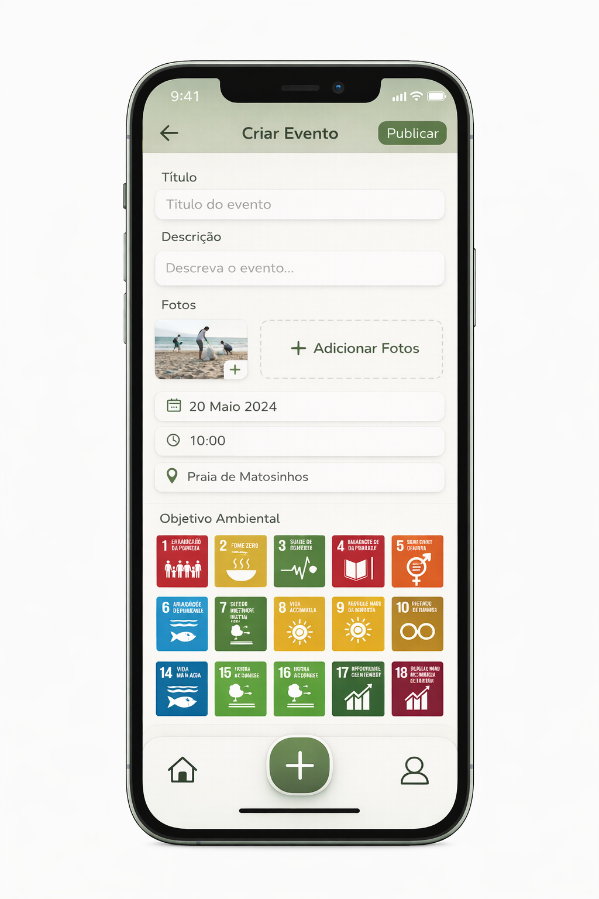
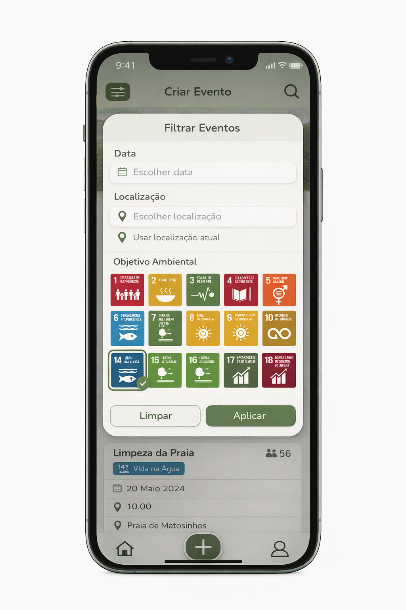

<!-- Template file for README.md for LEIC-ES-2025-26 -->

> [!NOTE] In this file, you will find the structure you should follow to document your mobile app in the README.md file for LEIC-ES-2025-26. It is a single file with guidelines. You can add more sections, but for assessment reasons and automation, please make sure to include all sections of this template. Your professors will clarify about specificities of your app.

# _Ripple Up_ Development Report

Welcome to the documentation of _Ripple Up_!

This Software Development Report, tailored for LEIC-ES-2025-26, provides comprehensive details about _Ripple Up_, starting from an high-level vision and going into low-level implementation decisions. 

It is organised by the following activities: 

* [Business modeling](#Business-Modelling) 
  * [Product Vision](#Product-Vision)
  * [Features and Assumptions](#Features-and-Assumptions)
* [Requirements](#Requirements)
  * [User stories](#User-stories)
  * [Domain model](#Domain-model)
  * [User interfaces](#User-interfaces)
  * [Validation of requirements through interviews](#Validation-of-requirements-through-interviews)
* [Architecture and Design](#Architecture-And-Design)
  * [Logical architecture](#Logical-Architecture)
  * [Physical architecture](#Physical-Architecture)
  * [Functional prototype](#Functional-Prototype)
* [Project management](#Project-Management)
  * [Sprint 0](#Sprint-0)
  * [Sprint 1](#Sprint-1)
  * [Sprint 2](#Sprint-2)
  * [Sprint 3](#Sprint-3)
  * [Final Release](#Final-Release)

Contributions are expected to be made exclusively by the initial team, but we may open them to the community, after the course, in all areas and topics: requirements, technologies, development, experimentation, testing, etc.

Please contact us!

Thank you!

* Artur Moreira - arturmoreira899@gmail.com
* Eduardo Santos - edu.santos4506@gmail.com
* David Gomes - david2006gomes@gmail.com
* Tiago Ribeiro - tiagoc8ribeiro@gmail.com
* Lourenço Paçô - lourencopaco06@gmail.com

---
## Business Modelling

Business modeling in software development involves defining the product's vision, understanding market needs, aligning features with user expectations, and setting the groundwork for strategic planning and execution.

### Product Vision

For people who want to make a positive impact in their communities, our platform is a collaborative event system that allows users to create, discover, and join humanitarian and community-help events.
<!-- 
Start by defining a clear and concise product vision for your app, to help members of the team, contributors, and users into focusing their often disparate views into a concise, visual, and short textual form. 

The vision should provide a "high concept" of the product for marketers, developers, and managers.

A product vision describes the essential of the product and sets the direction to where a product is headed, and what the product will deliver in the future. 

**We favor a catchy and concise statement, ideally one sentence.**

We suggest you use the product vision template described in the following link:
* [How To Create A Convincing Product Vision To Guide Your Team, by uxstudioteam.com](https://uxstudioteam.com/ux-blog/product-vision/)

To learn more about how to write a good product vision, please read:
* [Vision, by scrumbook.org](http://scrumbook.org/value-stream/vision.html)
* [Product Management: Product Vision, by ProductPlan](https://www.productplan.com/glossary/product-vision/)
* [20 Inspiring Vision Statement Examples (2019 Updated), by lifehack.org](https://www.lifehack.org/articles/work/20-sample-vision-statement-for-the-new-startup.html)
-->

### Features and Assumptions
 - Users Profile - Users can view and edit their personal profile, including name, photo, interests, and contact details.
 - Event Creation - Users can create events by providing details such as title, description, date, time, location, and participant limits.
 - Event Discovery - Users can browse and search for events based on categories, date, location, or keywords.
 - Join / Leave Events - Users can register for events they are interested in and leave events if they change their plans.
 - Event Management - Event organizers can edit, update, or cancel events they created.
 - Event history - Users can view a record of past events they attended or organized.
 - Event Notifications – Users receive notifications or reminders about upcoming events, updates, or cancellations.
 - Event Categories – Events can be classified into categories or tagged to improve search and discovery.
<!-- 
Indicate an  initial/tentative list of high-level features - high-level capabilities or desired services of the system that are necessary to deliver benefits to the users.
 - Feature XPTO - a few words to briefly describe the feature
 - Feature ABCD - ...
...

Optionally, indicate an initial/tentative list of assumptions that you are doing about the app and dependencies of the app to other systems.
-->

## Requirements

### User Stories

The system supports several user stories focused on enabling users to organize and participate in humanitarian events.

The main functionalities include:
- Creating humanitarian events
- Browsing available events
- Joining and leaving events
- Managing events created by the user
- Viewing event details and participants

Each user story is documented and tracked in the GitHub Project board with the label "user story".
<!-- 
In this section you should describe all kinds of requirements for your module: functional and non-functional requirements.

For LEIC-ES-2025-26, the requirements will be gathered and documented as user stories. 

Please add in this section a concise summary of all the user stories (not each user story!).

**User stories as GitHub Project Items**
The user stories themselves should be created and described as items in your GitHub Project with the label "user story". 

A user story is a description of a desired functionality told from the perspective of the user or customer. A starting template for the description of a user story is *As a < user role >, I want < goal > so that < reason >.*

Name the item with either the full user story or a shorter name (recommended). In the “comments” field, add relevant notes, mockup images, and acceptance test scenarios, linking to the acceptance tests when available, and finally estimate value and effort.

**INVEST in good user stories**. 
You may add more details after, but the shorter and complete, the better. In order to decide if the user story is good, please follow the [INVEST guidelines](https://xp123.com/articles/invest-in-good-stories-and-smart-tasks/).

**User interface mockups**.
After the user story text, you should add a draft of the corresponding user interfaces, a simple mockup or draft, if applicable.

**Acceptance tests**.
For each user story you should write also the acceptance tests (textually in [Gherkin](https://cucumber.io/docs/gherkin/reference/)), i.e., a description of scenarios (situations) that will help to confirm that the system satisfies the requirements addressed by the user story.

**Value and effort**.
At the end, it is good to add a rough indication of the value of the user story to the customers (e.g. [MoSCoW](https://en.wikipedia.org/wiki/MoSCoW_method) method) and the team should add an estimation of the effort to implement it using points in a kind-of-a Fibonnacci scale (1,2,3,5,8,13,20,40, no idea).

-->

### Domain model

### User interfaces

The main user interfaces of _Ripple Up_ were designed to support the core user flows of the application, namely browsing events, creating new events, filtering activities, and viewing event details.

The following mockups illustrate the main screens currently considered for the application:

  
  
  

### Validation of requirements through interviews

To validate the requirements, we conducted two semi-structured interviews with potential target users of the application. The goal was to understand what users value in this type of platform, which information they need before joining an activity, and which features they consider most useful.

The interviews showed that users are more interested in activities with a clear purpose and visible impact. They also highlighted the importance of having complete information before participating, especially the activity description, location, schedule, and number of participants.

Another important conclusion was the usefulness of filtering features, particularly by interest and location, to help users find relevant activities more easily. The idea of a participant-only chat was also seen as useful for coordination after joining an event.

Based on this feedback, the Product Backlog was refined by reinforcing the priority of event filtering, detailed event information, and participant coordination features. Although only two interviews were conducted, they provided a useful initial validation of the main requirements.

<!-- 
To better understand the context of the software system, it is useful to have a simple UML class diagram with all and only the key concepts (names, attributes) and relationships involved of the problem domain addressed by your app. 
Also provide a short textual description of each concept (domain class). 

Example:
 

  

-->

## Architecture and Design

The architecture of Ripple Up was designed to ensure scalability, maintainability, and clear separation of concerns. The system follows a layered approach, allowing independent development and testing of different components.

The application is made to run the phone letting you explore and join events it is built with Flutter and supported by external cloud services for data persistence and additional functionalities.

<!--
The architecture of a software system encompasses the set of key decisions about its organization. 

A well written architecture document is brief and reduces the amount of time it takes new programmers to a project to understand the code to feel able to make modifications and enhancements.

To document the architecture requires describing the decomposition of the system in their parts (high-level components) and the key behaviors and collaborations between them. 

In this section you should start by briefly describing the components of the project and their interrelations. You should describe how you solved typical problems you may have encountered, pointing to well-known architectural and design patterns, if applicable.
-->

### Logical architecture
The system follows a layered logical architecture composed of three main components: the User Interface, Business Logic, and Data Access layers.
- The User Interface (UI) is responsible for handling user interactions and presenting visual elements. It captures user input and displays processed data in a user-friendly format.
- The Business Logic layer manages the core functionalities of the application. It processes user inputs, applies application rules, and coordinates operations between the UI and external services.
- The Data Access layer is responsible for handling communication with external systems and services. This includes interactions with the database and third-party APIs.

<!--
The purpose of this subsection is to document the high-level logical structure of the code (Logical View), using a UML diagram with logical packages, without the worry of allocating to components, processes or machines.

It can be beneficial to present the system in a horizontal decomposition, defining layers and implementation concepts, such as the user interface, business logic and concepts.

Example of _UML package diagram_ showing a _logical view_ of the Eletronic Ticketing System (to be accompanied by a short description of each package):

-->

### Physical architecture
The physical architecture consists of a client-side mobile application and cloud-based external services.

- The mobile application, developed using Flutter, runs on the user’s device. It contains the User Interface, Business Logic, and part of the Data Access layer. Additionally, it may use local storage mechanisms for caching and offline capabilities.
- The application communicates directly with cloud services provided by Firebase, which handles data persistence through Cloud Firestore and file storage services.
- External location-based functionalities are supported through the Google Maps Platform, which provides APIs for mapping and geocoding.

<!--
The goal of this subsection is to document the high-level physical structure of the software system (machines, connections, software components installed, and their dependencies) using UML deployment diagrams (Deployment View) or component diagrams (Implementation View), separate or integrated, showing the physical structure of the system.

It should describe also the technologies considered and justify the selections made. Examples of technologies relevant for ESOF are, for example, frameworks for mobile applications (such as Flutter).

Example of _UML deployment diagram_ showing a _deployment view_ of the Eletronic Ticketing System (please notice that, instead of software components, one should represent their physical/executable manifestations for deployment, called artifacts in UML; the diagram should be accompanied by a short description of each node and artifact):

-->

### Functional prototype

The current version of Ripple Up is a working prototype that shows the main features of the application.

The app already includes the most important features:
- View a list of events
- Create new events
- Filter events based on location, objectives, and number of participants
- View event details
- Join events
- Mark events as favorites and view them in a separate page

The prototype also includes the following screens:
- Home page – shows all available events
- Create event screen – allows users to add a new event
- Filter screen – lets users filter events
- Event details popup/page – shows full information about an event
- Favorites page – shows events marked as favorite

Future things to improve:
- Save data permanently (currently events are temporary)
- Add user accounts and authentication
- Improve the design and user experience
- View what events you joined
- Notification reminders
- Activity chats

<!--
To help on validating all the architectural, design and technological decisions made, we usually implement a functional prototype, a thin vertical slice of the system integrating as much technologies as we can.

In this subsection please describe which feature, or part of it, you have implemented, and how, together with a snapshot of the user interface, if applicable.

At this phase, instead of a complete user story, you can simply implement a small part of a feature that demonstrates thay you can use the technology, for example, show a screen with the app credits (name and authors).
-->

## Project management
<!--
Software project management is the art and science of planning and leading software projects, in which they are planned, implemented, monitored and controlled.

In the context of ESOF, we recommend each team to adopt a set of project management practices and tools capable of registering tasks, assigning tasks to team members, adding estimations to tasks, monitor tasks progress, and therefore being able to track their projects.

Common practices of managing agile software development with Scrum are: backlog management, release management, estimation, Sprint planning, Sprint development, acceptance tests, and Sprint retrospectives.

You can find below information and references related with the project management: 

* Backlog management: Product backlog and Sprint backlog in a [Github Projects board](https://github.com/orgs/FEUP-LEIC-ES-2023-24/projects/64);
* Release management: [v0](#), v1, v2, v3, ...;
* Sprint planning and retrospectives: 
  * plans: screenshots of Github Projects board at begin and end of each Sprint;
  * retrospectives: meeting notes in a document in the repository, addressing the following questions:
    * Did well: things we did well and should continue;
    * Do differently: things we should do differently and how;
    * Puzzles: things we don’t know yet if they are right or wrong;
    * list of a few improvements to implement next Sprint;

-->

### Sprint 0

### Sprint 1

### Sprint 2

### Sprint 3

### Sprint 4

### Final Release
