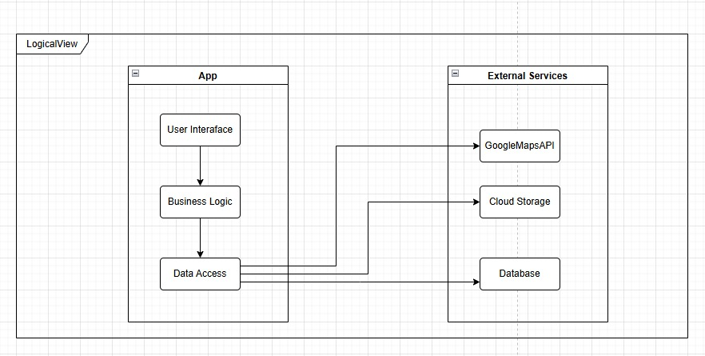
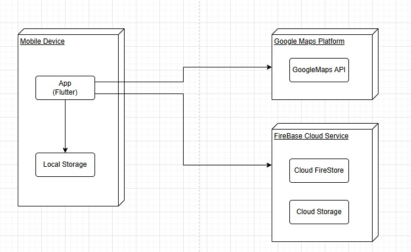

<!-- Template file for README.md for LEIC-ES-2025-26 -->

> [!NOTE] In this file, you will find the structure you should follow to document your mobile app in the README.md file for LEIC-ES-2025-26. It is a single file with guidelines. You can add more sections, but for assessment reasons and automation, please make sure to include all sections of this template. Your professors will clarify about specificities of your app.

# _Ripple Up_ Development Report

[](https://github.com/LEIC-ES-2025-26-2LEIC05/T5/actions/workflows/flutter.yml)

Welcome to the documentation of _Ripple Up_!

This Software Development Report, tailored for LEIC-ES-2025-26, provides comprehensive details about _Ripple Up_, starting from an high-level vision and going into low-level implementation decisions. 

It is organised by the following activities: 

* [Business modeling](#Business-Modelling) 
  * [Product Vision](#Product-Vision)
  * [Features and Assumptions](#Features-and-Assumptions)

* [Requirements](#Requirements)
  * [User stories](#User-stories)
  * [Domain model](#Domain-model)
  * [User interfaces](#User-interfaces)
  * [Validation of requirements through interviews](#Validation-of-requirements-through-interviews)

* [Architecture and Design](#Architecture-And-Design)
  * [Logical architecture](#Logical-Architecture)
  * [Physical architecture](#Physical-Architecture)
  * [Functional prototype](#Functional-Prototype)

* [Development Environment](#Development-Environment)
* [Tools Used](#Tools-Used)
* [Use of AI Tools](#Use-of-AI-Tools)

* [Project management](#Project-Management)
  * [Definition of Ready (DoR)](#Definition-of-Ready-DoR)
  * [Product Backlog Refinement](#Product-Backlog-Refinement)
  * [Enabling Specification](#Enabling-Specification)
  * [INVEST Criteria](#INVEST-Criteria)
  * [Definition of Done (DoD)](#Definition-of-Done-DoD)
  * [Sprint 0](#Sprint-0)
  * [Sprint 1](#Sprint-1)
  * [Sprint 2](#Sprint-2)
  * [Sprint 3](#Sprint-3)
  * [Final Release](#Final-Release)

Contributions are expected to be made exclusively by the initial team, but we may open them to the community, after the course, in all areas and topics: requirements, technologies, development, experimentation, testing, etc.

Please contact us!

Thank you!

* Artur Moreira - arturmoreira899@gmail.com
* Eduardo Santos - edu.santos4506@gmail.com
* David Gomes - david2006gomes@gmail.com
* Tiago Ribeiro - tiagoc8ribeiro@gmail.com
* Lourenço Paçô - lourencopaco06@gmail.com

---
## Business Modelling

Business modeling in software development involves defining the product's vision, understanding market needs, aligning features with user expectations, and setting the groundwork for strategic planning and execution.

### Product Vision

For people who want to make a positive impact in their communities, our platform is a collaborative event system that allows users to create, discover, and join humanitarian and community-help events.
<!-- 
Start by defining a clear and concise product vision for your app, to help members of the team, contributors, and users into focusing their often disparate views into a concise, visual, and short textual form. 

The vision should provide a "high concept" of the product for marketers, developers, and managers.

A product vision describes the essential of the product and sets the direction to where a product is headed, and what the product will deliver in the future. 

**We favor a catchy and concise statement, ideally one sentence.**

We suggest you use the product vision template described in the following link:
* [How To Create A Convincing Product Vision To Guide Your Team, by uxstudioteam.com](https://uxstudioteam.com/ux-blog/product-vision/)

To learn more about how to write a good product vision, please read:
* [Vision, by scrumbook.org](http://scrumbook.org/value-stream/vision.html)
* [Product Management: Product Vision, by ProductPlan](https://www.productplan.com/glossary/product-vision/)
* [20 Inspiring Vision Statement Examples (2019 Updated), by lifehack.org](https://www.lifehack.org/articles/work/20-sample-vision-statement-for-the-new-startup.html)
-->


### Features and Assumptions
 - Users Profile - Users can view and edit their personal profile, including name, photo, interests, and contact details.
 - Event Creation - Users can create events by providing details such as title, description, date, time, location, and participant limits.
 - Event Discovery - Users can browse and search for events based on categories, date, location, or keywords.
 - Join / Leave Events - Users can register for events they are interested in and leave events if they change their plans.
 - Event Management - Event organizers can edit, update, or cancel events they created.
 - Event history - Users can view a record of past events they attended or organized.
 - Event Notifications – Users receive notifications or reminders about upcoming events, updates, or cancellations.
 - Event Categories – Events can be classified into categories or tagged to improve search and discovery.
<!-- 
Indicate an  initial/tentative list of high-level features - high-level capabilities or desired services of the system that are necessary to deliver benefits to the users.
 - Feature XPTO - a few words to briefly describe the feature
 - Feature ABCD - ...
...

Optionally, indicate an initial/tentative list of assumptions that you are doing about the app and dependencies of the app to other systems.
-->

## Requirements

### User Stories

The system supports several user stories focused on enabling users to organize and participate in humanitarian events.

The main functionalities include:
- Creating humanitarian events
- Browsing available events
- Joining and leaving events
- Favourite events
- Managing events created by the user
- Viewing event details and participants

Each user story is documented and tracked in the GitHub Project board with the label "user story".
<!-- 
In this section you should describe all kinds of requirements for your module: functional and non-functional requirements.

For LEIC-ES-2025-26, the requirements will be gathered and documented as user stories. 

Please add in this section a concise summary of all the user stories (not each user story!).

**User stories as GitHub Project Items**
The user stories themselves should be created and described as items in your GitHub Project with the label "user story". 

A user story is a description of a desired functionality told from the perspective of the user or customer. A starting template for the description of a user story is *As a < user role >, I want < goal > so that < reason >.*

Name the item with either the full user story or a shorter name (recommended). In the “comments” field, add relevant notes, mockup images, and acceptance test scenarios, linking to the acceptance tests when available, and finally estimate value and effort.

**INVEST in good user stories**. 
You may add more details after, but the shorter and complete, the better. In order to decide if the user story is good, please follow the [INVEST guidelines](https://xp123.com/articles/invest-in-good-stories-and-smart-tasks/).

**User interface mockups**.
After the user story text, you should add a draft of the corresponding user interfaces, a simple mockup or draft, if applicable.

**Acceptance tests**.
For each user story you should write also the acceptance tests (textually in [Gherkin](https://cucumber.io/docs/gherkin/reference/)), i.e., a description of scenarios (situations) that will help to confirm that the system satisfies the requirements addressed by the user story.

**Value and effort**.
At the end, it is good to add a rough indication of the value of the user story to the customers (e.g. [MoSCoW](https://en.wikipedia.org/wiki/MoSCoW_method) method) and the team should add an estimation of the effort to implement it using points in a kind-of-a Fibonnacci scale (1,2,3,5,8,13,20,40, no idea).

-->

### Domain model


The domain model of _RippleUP_ represents the core entities and relationships required to support the platform’s main functionality.

- **User** represents a platform user. A user is identified by a unique identifier and stores personal information such as name, email, and profile image. Users interact with the platform by creating events, participating in activities, exchanging messages, and receiving notifications.
- **Event** represents an activity available in the platform. An event is identified by a unique identifier and contains relevant information such as title, description, date and time, maximum number of participants, current status, location, and the environmental goal it addresses.
- **Participation** models the association between a user and an event. This entity allows the system to register when a user joined or left an event, through the attributes `entryDate` and `exitDate`.
- **Message** models communication between participants in the context of an event. Each message stores its content and timestamp and is associated with exactly one user and one event.
- **Notification** models alerts generated by the system in response to relevant event actions, such as event creation, cancellation, updates, or participation changes. Each notification is associated with one user and one event.

Overall, the domain model reflects the essential structure of the system and supports the application’s main user flows: discovering events, participating in activities, coordinating with other users, and receiving event-related updates.

### User interfaces

The main user interfaces of _Ripple Up_ were designed to support the core user flows of the application, namely browsing events, creating new events, filtering activities, and viewing event details.

The following mockups illustrate the main screens currently considered for the application:

<p align="center">
  
  
  
</p>


### Validation of requirements through interviews

To validate the requirements, we conducted two semi-structured interviews with potential target users of the application. The goal was to understand what users value in this type of platform, which information they need before joining an activity, and which features they consider most useful.

The interviews showed that users are more interested in activities with a clear purpose and visible impact. They also highlighted the importance of having complete information before participating, especially the activity description, location, schedule, and number of participants.

Another important conclusion was the usefulness of filtering features, particularly by interest and location, to help users find relevant activities more easily. The idea of a participant-only chat was also seen as useful for coordination after joining an event.

Based on this feedback, the Product Backlog was refined by reinforcing the priority of event filtering, detailed event information, and participant coordination features. Although only two interviews were conducted, they provided a useful initial validation of the main requirements.

<!-- 
To better understand the context of the software system, it is useful to have a simple UML class diagram with all and only the key concepts (names, attributes) and relationships involved of the problem domain addressed by your app. 
Also provide a short textual description of each concept (domain class). 

Example:
 <p align="center" justify="center">
  
</p>
-->


## Architecture and Design

The architecture of Ripple Up was designed to ensure scalability, maintainability, and clear separation of concerns. The system follows a layered approach, allowing independent development and testing of different components.

The application runs on mobile devices, allowing users to explore and participate in events. It is built with Flutter and designed to support integration with external cloud services for data persistence and additional functionalities.

The design and implementation were continuously reviewed and refined throughout the project to ensure consistency and ongoing improvement of the system.

<!--
The architecture of a software system encompasses the set of key decisions about its organization. 

A well written architecture document is brief and reduces the amount of time it takes new programmers to a project to understand the code to feel able to make modifications and enhancements.

To document the architecture requires describing the decomposition of the system in their parts (high-level components) and the key behaviors and collaborations between them. 

In this section you should start by briefly describing the components of the project and their interrelations. You should describe how you solved typical problems you may have encountered, pointing to well-known architectural and design patterns, if applicable.
-->


### Logical architecture
The system follows a layered logical architecture composed of three main components: the User Interface, Business Logic, and Data Access layers.
- The User Interface (UI) is responsible for handling user interactions and presenting visual elements. It captures user input and displays processed data in a user-friendly format.
- The Business Logic layer manages the core functionalities of the application. It processes user inputs, applies application rules, and coordinates operations between the UI and external services.
- The Data Access layer is responsible for handling communication with external systems and services. This includes interactions with the database and third-party APIs.

<!--
The purpose of this subsection is to document the high-level logical structure of the code (Logical View), using a UML diagram with logical packages, without the worry of allocating to components, processes or machines.

It can be beneficial to present the system in a horizontal decomposition, defining layers and implementation concepts, such as the user interface, business logic and concepts.

Example of _UML package diagram_ showing a _logical view_ of the Eletronic Ticketing System (to be accompanied by a short description of each package):


-->


### Physical architecture

The physical architecture of _RippleUP_ is currently based on a client-side mobile application developed with Flutter and executed on the user’s device.

At this stage, the prototype runs mostly as a self-contained application. The mobile app includes the user interface, business logic, and local access to mock data used to simulate the behaviour of the system. This approach allowed the team to validate the main user flows and architectural decisions without depending on a complete backend infrastructure.

The main physical node of the current prototype is:

- **Mobile Device** – executes the Flutter application and contains the presentation layer, application logic, and local mock data repositories.

Although the current prototype does not yet integrate external production services, the architecture was designed to support future extension with cloud-based components. These may include backend services for persistent data storage, user authentication, notifications, and third-party APIs for geolocation and mapping support.

This separation between the mobile client and future external services helps keep the architecture modular, scalable, and easier to evolve in later development stages.



<!--
The goal of this subsection is to document the high-level physical structure of the software system (machines, connections, software components installed, and their dependencies) using UML deployment diagrams (Deployment View) or component diagrams (Implementation View), separate or integrated, showing the physical structure of the system.

It should describe also the technologies considered and justify the selections made. Examples of technologies relevant for ESOF are, for example, frameworks for mobile applications (such as Flutter).

Example of _UML deployment diagram_ showing a _deployment view_ of the Eletronic Ticketing System (please notice that, instead of software components, one should represent their physical/executable manifestations for deployment, called artifacts in UML; the diagram should be accompanied by a short description of each node and artifact):


-->


### Functional prototype

The current version of Ripple Up is a working prototype that shows the main features of the application.

The current prototype already supports the main user flows of the application:
- View a list of events
- Create new events with detailed inputs (description, capacity, dates, objectives, location)
- Filter events based on multiple criteria (location, objectives, participants)
- View event details
- Join events
- Favourite events

The prototype also includes the following screens:
- Home page – shows all available events
- Create event screen – allows users to add a new event
- Filter screen – lets users filter events
- Event details popup/page – shows full information about an event

Below are screenshots of the current implementation:
<p align="center">
  
  
  
  
</p>

Future things to improve:
- Persist data using a backend service (e.g., Firebase)
- Mark events as favorites and manage them
- Improve the design and user experience
- View what events you joined
- Notification reminders
- Activity chats

<!--
To help on validating all the architectural, design and technological decisions made, we usually implement a functional prototype, a thin vertical slice of the system integrating as much technologies as we can.

In this subsection please describe which feature, or part of it, you have implemented, and how, together with a snapshot of the user interface, if applicable.

At this phase, instead of a complete user story, you can simply implement a small part of a feature that demonstrates thay you can use the technology, for example, show a screen with the app credits (name and authors).
-->

## Development Environment

To run the project locally:

- Install Flutter (stable version)
- Run `flutter pub get`
- Use an emulator or physical device
- Run `flutter run`

The project was developed using Flutter and Dart.

## Tools Used

- Flutter
- Dart
- GitHub & GitHub Actions
- Firebase (planned)
- AI tools for development support

## Use of AI Tools

AI tools were used during the development of this project to assist with code structuring, debugging, and the creation of small tests during development, including support for unit testing.

All generated suggestions were carefully reviewed, adapted, and integrated into the project to ensure correctness and alignment with the application requirements.

AI was used as a support tool to improve productivity, while all design decisions and final implementations were validated by the development team.

## Project management

To manage the development of Ripple Up, the team followed an agile approach inspired by Scrum. Work was divided into multiple sprints, allowing continuous improvement of the application.

We used GitHub to organize tasks and track progress. Each task was associated with user stories.

#### Definition of Ready (DoR)

Before a user story is included in a sprint, it must satisfy the following criteria:

- Clearly described (who, what, why)
- Small enough to be completed within the sprint
- Has acceptance criteria defined
- Estimated using story points
- Dependencies identified (if any)

This ensures that backlog items are well-prepared and ready for development.

#### Product Backlog Refinement

The Product Backlog was continuously reviewed and refined throughout the project.

This process included:
- Adding and updating user stories based on project evolution
- Prioritizing items according to their value and importance
- Estimating effort using story points
- Clarifying requirements and splitting larger items into smaller tasks when needed

Refinement activities were supported by feedback gathered during requirement validation and ongoing development.

#### Enabling Specification

During development, additional technical tasks were identified and added to the backlog to support the implementation of user stories.

These tasks included improving data handling, refining UI components, and ensuring proper interaction between different layers of the application.

This helped ensure that the system remained functional and consistent as new features were developed.

#### INVEST Criteria

User stories were defined following the INVEST principles:

- Independent – user stories are self-contained and do not depend heavily on others  
- Negotiable – details can be refined during development  
- Valuable – each story delivers value to the end-user  
- Estimable – effort can be estimated using story points  
- Small – stories are small enough to be completed within a sprint  
- Testable – acceptance of each story can be verified  

This approach helped ensure that backlog items were clear, manageable, and valuable.

#### Definition of Done (DoD)

A task or user story is considered done when:

- The functionality is fully implemented
- The code is integrated into the main branch
- The feature is tested and working as expected
- The corresponding item is moved to "Done" in the Scrum board

This ensures consistency and quality across all delivered features.


<!--
Software project management is the art and science of planning and leading software projects, in which they are planned, implemented, monitored and controlled.

In the context of ESOF, we recommend each team to adopt a set of project management practices and tools capable of registering tasks, assigning tasks to team members, adding estimations to tasks, monitor tasks progress, and therefore being able to track their projects.

Common practices of managing agile software development with Scrum are: backlog management, release management, estimation, Sprint planning, Sprint development, acceptance tests, and Sprint retrospectives.

You can find below information and references related with the project management: 

* Backlog management: Product backlog and Sprint backlog in a [Github Projects board](https://github.com/orgs/FEUP-LEIC-ES-2023-24/projects/64);
* Release management: [v0](#), v1, v2, v3, ...;
* Sprint planning and retrospectives: 
  * plans: screenshots of Github Projects board at begin and end of each Sprint;
  * retrospectives: meeting notes in a document in the repository, addressing the following questions:
    * Did well: things we did well and should continue;
    * Do differently: things we should do differently and how;
    * Puzzles: things we don’t know yet if they are right or wrong;
    * list of a few improvements to implement next Sprint;

-->

### Sprint 0

The goal of Sprint 0 was to prepare the project foundation and align the team before starting development.

During this sprint, the team focused on:

- Defining the product vision and identifying the main features of the application
- Creating and organizing the GitHub repository and project board
- Setting up the development environment using Flutter
- Designing the initial architecture (layered structure: UI, Business Logic, Data)
- Creating initial user stories and prioritizing them 
- Designing the first UI mockups for the main screens (feed, event creation, filters)
- Establishing team workflow, including task assignment and version control strategy

This sprint ensured that the team had a clear direction and a structured plan for development.

### Sprint 1

#### Sprint Planning

The goal of Sprint 1 was to deliver a first functional increment of *Ripple Up*, focusing on the core user flow of discovering and participating in environmental events.

The selected user stories for this sprint focused on the core functionalities of the application:

- Event browsing (feed and filtering)
- Event details visualization
- Event participation (join and leave events)
- Event creation and management (create, delete, set participant limits, define dates and status)
- Basic user features (login and account-related actions)

These items were selected to deliver a complete and functional user flow while ensuring the scope was feasible within the sprint effort.

At the beginning of the sprint, all selected items were placed in the "Sprint Backlog" column, with no tasks in progress or completed.

<p align="center">
  
  
</p>

---

#### Sprint Development

During the sprint, development followed an incremental approach where tasks were self-assigned and moved across the board:

- From **Sprint Backlog** → **In Progress**
- From **In Progress** → **Done**

The implementation focused on delivering a vertical slice of the application, integrating UI, business logic, and data layers.

Main functionalities implemented:
- Event listing (feed)
- Event creation with detailed inputs (name, description, capacity, dates, objectives, location)
- Event filtering based on multiple criteria (objectives, participants, location)
- Event details visualization
- Event participation (join and leave events)
- Event management features (delete event, set participant limits, define event dates and status)
- Basic user features (login and account-related actions)

---

#### Testing

Basic testing was performed to validate core functionalities such as event creation, browsing, and participation. User acceptance was verified through manual testing based on defined scenarios.

---

#### Sprint Review

At the end of Sprint 1, a functional product increment was achieved.
Feedback was collected during the sprint review from team members and peers. The feedback highlighted the importance of improving data persistence and enhancing user experience, which will be addressed in future sprints.

The application now allows users to:
- Browse environmental events
- View detailed information about each event
- Create and manage events
- Filter events according to user preferences
- Join and leave events
- Favourite events
- Interact with event properties such as participant limits, dates, and status

This increment delivers value to end-users by enabling meaningful participation in environmental initiatives, directly supporting the product vision.

<p align="center">
  
  
</p>

---

#### Release

A release was created in GitHub for Sprint 1:

- **Version:** v1 - Sprint 1  
- Includes a functional version of the application  
- Can be executed on a mobile device or emulator

---

#### Sprint Retrospective

**Did well:**
- Clear and well-structured architecture with separation of concerns (UI, ViewModels, and data layer)
- Successful delivery of a functional prototype with a complete user flow
- Implementation of core features end-to-end (event creation, browsing, filtering, and participation)

**Do differently:**
- Improve task distribution and collaboration within the team
- Break down user stories into smaller and more manageable tasks
- Compare planned vs completed work to better estimate future sprints
- Plan the sprint scope more carefully to better match the available effort

**Puzzles:**
- How to design and integrate a proper data persistence solution (database/backend)
- How to effectively manage task distribution and coordination within the team during development

### Sprint 2

#### Sprint Planning

The goal of Sprint 2 was to extend the first functional increment of *Ripple Up* by improving user interaction, event participation, communication, feedback, profile management, and overall application quality.

The selected backlog items for this sprint focused on:

- Improving event location handling
- Adding communication between event participants
- Adding event feedback and review functionality
- Improving user profile and account management
- Adding permissions for event-related actions
- Improving completed event filtering and joined events visualization
- Improving UI consistency through reusable components
- Improving quality assurance and development workflow

At the beginning of the sprint, the selected Product Backlog Items were moved into the Sprint Backlog and assigned according to team availability.

<p align="center">
  
  
</p>

---

#### Sprint Development

During Sprint 2, the team continued following an incremental development process. Tasks were developed in separate branches and integrated through pull requests after implementation and validation.

Main functionalities implemented during this sprint:

- Event locations with improved location selection
- Activity chat for event participants
- Definitions page
- Change password functionality
- Event feedback page
- Backend support for event reviews
- Create review functionality
- Delete review functionality
- Review sorting functionality
- User profile page
- Event permissions
- Completed event filtering
- View joined events functionality
- Reusable widgets for improved UI structure

These features improved the application by making event participation more complete, adding post-event feedback, improving account-related actions, and making the interface easier to maintain.

---

#### Testing and Quality Assurance

During Sprint 2, the team increased the automated test coverage of the application and improved the CI workflow used to validate the project.

The project currently contains 14 test files organized by responsibility:

- `test/services/` – tests for service logic, such as event filtering and review management
- `test/viewModels/` – tests for view model behavior, including events, messages, and reviews
- `test/views/dialogs/` – widget tests for dialogs such as event details and event filtering
- `test/views/pages/` – widget tests for pages such as home, settings, feedback, profile editing, and password change
- `test/views/widgets/` – widget tests for reusable UI components such as current events and review cards

Current test structure:

```txt
test
├── services
│   ├── event_filter_service_test.dart
│   └── review_service_test.dart
├── viewModels
│   ├── event_view_model_test.dart
│   ├── messageViewModel_test.dart
│   └── review_viewModel_test.dart
└── views
    ├── dialogs
    │   ├── event_details_dialog_test.dart
    │   └── event_filter_dialog_test.dart
    ├── pages
    │   ├── change_password_page_test.dart
    │   ├── edit_profile_page_test.dart
    │   ├── feedback_page_test.dart
    │   ├── home_page_test.dart
    │   └── settings_page_test.dart
    └── widgets
        ├── current_events_widget_test.dart
        └── review_card_test.dart
```

Automated tests can be executed with:

```bash
flutter test
```

Static analysis is used to detect possible code issues before merging changes:

```bash
flutter analyze --no-fatal-infos --no-fatal-warnings
```

Code formatting is checked using Dart's formatter:

```bash
dart format --set-exit-if-changed .
```

Although the project does not currently use a separate `integration_test/` directory, several widget tests validate interactions between UI components, view models, and mocked application logic.

---

#### Acceptance Tests

Acceptance tests were used to validate whether the implemented features satisfy the expected user interactions.

The detailed acceptance criteria for each Product Backlog Item were documented in the corresponding GitHub Project items. Some scenarios were validated manually, while others were supported by Flutter widget tests located under `test/views/`.

Examples of acceptance scenarios validated during Sprint 2:

```gherkin
Feature: Create event review

Scenario: User creates a review for a completed event
  Given the user participated in a completed event
  When the user opens the feedback page and submits a review
  Then the review should be created and displayed in the event feedback section
```

```gherkin
Feature: View joined events

Scenario: User views events they joined
  Given the user has joined one or more events
  When the user opens the joined events section
  Then the system should display the events joined by that user
```

```gherkin
Feature: Change password

Scenario: User changes their password
  Given the user is authenticated
  When the user enters the required password information and confirms the change
  Then the system should process the password change request
```

These acceptance tests helped confirm that the implemented features were aligned with the expected user behavior and delivered value to end-users.

---

#### Bugs, Defects, Fixes and Improvements

Bugs, defects, fixes, and improvements identified during development and testing are documented in a separate bug log to keep the README concise.

The full bug log can be found in [`BUGS.md`](BUGS.md).

During Sprint 2, three new defects were added to the bug log:

- **BUG-04** — City field was not reset after changing district
- **BUG-05** — Review list was not immediately updated after deleting a review
- **BUG-06** — Flutter web server failed when executed from the wrong directory

Each bug entry includes its description, category, priority, reproduction steps, expected and actual behavior, implemented fix, and verification status.

---

#### DevOps and Deployment

The project uses GitHub Actions for Continuous Integration.

The workflow runs automatically on every push and pull request. It is divided into four jobs:

- **Format** – installs dependencies and checks Dart formatting with `dart format --set-exit-if-changed .`
- **Analyze** – runs static analysis with `flutter analyze --no-fatal-infos --no-fatal-warnings`
- **Test** – runs the automated test suite with `flutter test`
- **Build Web** – validates that the application can be built for web release

The CI workflow helps ensure that new contributions are formatted correctly, do not introduce static analysis issues, pass the automated tests, and can still be built successfully.

The application can be built locally for web using:

```bash
flutter build web --release
```

During Sprint 2, the application was validated through automated CI checks and local Flutter execution.

---

#### Branching Strategy

During Sprint 2, the team followed a GitHub Flow-based workflow.

The `main` branch was used as the stable branch of the project. New features, fixes, and improvements were developed in separate branches created from `main`.

Feature branches used descriptive names related to the work being implemented, for example:

- `feat/expand-event-locations`
- `feat/join-event`
- `feat/delete-reviews`

After development, changes were submitted through pull requests. Before being merged, each pull request had to pass the available quality checks, including formatting, static analysis, automated tests, and web build validation.

After a pull request was merged, the corresponding branch was deleted locally and remotely to keep the repository organized.

This workflow helped the team isolate changes, review work before integration, and keep the main branch stable throughout the sprint.

---

#### Use of AI Tools During Sprint 2

During Sprint 2, AI tools were used as support for documentation, debugging, test planning, and development workflow decisions.

AI assistance was used for:

- Drafting GitHub issue and pull request descriptions
- Suggesting commit messages
- Explaining Flutter, Git, and CI-related errors
- Supporting README and changelog documentation
- Helping identify possible bugs and improvements
- Supporting the creation of test and acceptance test descriptions

Example prompts used during the sprint:

| Prompt | Purpose |
|---|---|
| "Generate a commit message for the event location filtering feature" | Commit message support |
| "Explain why the Flutter web server fails when running from the build/web directory" | Debugging support |
| "Suggest a README section for documenting CI, tests and quality metrics" | Documentation support |
| "Create bug descriptions for Sprint 2" | Bug documentation support |
| "Explain Flutter format CI failure" | CI/debugging support |

All AI-generated suggestions were reviewed, adapted, and validated by the team before being included in the project.

When AI-assisted code was used, it was committed separately when applicable, and the corresponding Product Backlog Items were labeled with `MisterAI`.

---

#### Sprint Review

At the end of Sprint 2, a more complete and refined product increment was achieved, building on the core functionality developed in the previous sprint. The sprint focused on improving usability, interaction, and overall application consistency, while also addressing system organization and preparing the foundation for future enhancements such as real-time features and improved responsiveness.

The application now allows users to:

- Access and manage their personal profile
- Participate in event-specific chats with other users
- Leave feedback and reviews on events
- Sort and manage reviews dynamically
- View and filter completed events
- Access joined events in a dedicated view
- Interact with improved event permissions and controls
- Navigate the application more smoothly with a consistent and standardized UI
- Change their account password securely
- Access a definitions page for better understanding of the platform

This increment delivers additional value to end-users by improving interaction, personalization, and engagement within the platform.

<p align="center">
  
  
  

</p>

---

#### Release

TODO: create and document the GitHub release after all Sprint 2 features are completed, merged into `main`, and added to `CHANGELOG.md`. 
 - Version v2 - Sprint 2. --reference to the release here--
 - Includes a functional version of the application.
 - Can be executed on mobile device or emulator.

---

#### Sprint Retrospective

**Did well:**
- Bigger user stories were divided into smaller ones to avoid overwork on some team members
- The major good principles for a good software development like separation of concerns, modularity, reusability, and clean architecture were followed, along with good communication between all team members
- Significant improvements in UI consistency and overall application workflow
- Reusable components/widgets were introduced, improving maintainability and scalability

**Do differently:**
- Allocate more time for testing and validation of features before completion
- Enhance coordination when working on interdependent features (e.g., frontend and backend integration)
- Define clearer acceptance criteria for user stories to avoid rework

**Puzzles:**
- How to implement real-time features to provide a smoother and more interactive user experience
 - How to efficiently manage synchronization between frontend and backend for dynamic data (like reviews and event updates)

### Sprint 3

### Final Release
